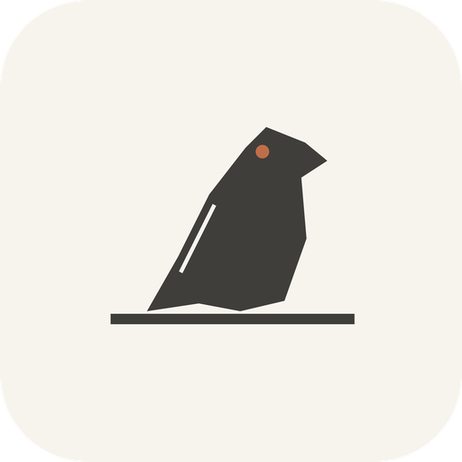
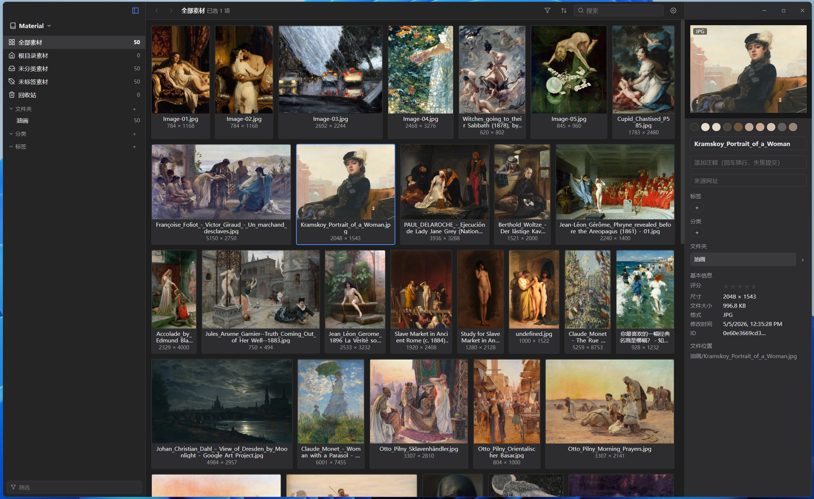

  

<h1 align="center">hawk</h1>

对标 Eagle 的开源图片素材管理工具

  
  
  
  
  

- 非侵入式资源管理：资源以文件夹的形式进行管理，非侵入式
- 自由开放：开放的 REST API，方便生态接入
- 免费

## 截图

## 核心特性

### 非侵入式资源管理

hawk 不会将你的素材"导入"到某个专有仓库中。你的文件始终保存在原来的文件夹里，素材目录中也不会出现任何 hawk 的文件——所有数据都收敛在一个 `.hawk/` 隐藏文件夹中。

- 卸载 hawk 后，你的素材文件纹丝不动
- 原有的文件夹组织习惯完全保留
- 与网盘（Dropbox、iCloud、Syncthing、OneDrive）天然兼容

### SQLite 元数据与相似图片查找

素材参数（标签、评分、备注等）统一存放在 `.hawk/metadata.db`，单文件 SQLite 提供事务写入与快速启动，不再有 TOML/数据库双模式。SQLite 仅本机使用，不参与网盘同步。

支持 pHash 视觉近重复查找：缩放、格式转换、重新压缩后的图片可按汉明距离检索和排序，结果复用虚拟网格；计算在 daemon 后台完成，广域网仍只传缩略图。设置中的「存储 → 重复图片」还可按相似组或相同内容多位置扫描，展示文件大小、像素和路径，用户逐位置确认后移入回收站。

### 前后端解耦

后端是独立的 Rust 服务，前端只通过 REST API 通信。桌面版用 Electron 壳拉起后端进程；同一套后端未来可直接部署为多人使用的服务器版本。

## 文档

**总体**

- [架构设计](docs/architecture.md)：进程模型、桌面/服务器部署形态、仓库结构
- [技术栈](docs/tech-stack.md)：语言与框架选型
- [发布流程](docs/release.md)：stable/nightly 双通道、版本号规则、发版步骤与 CI 行为

**前端**（[hawk-app](hawk-app/README.md)）

- [hawk-app 设计](docs/frontend/hawk-app.md)：Electron 壳 + Vue 前端的界面与接入设计
- [iOS 客户端设计](docs/frontend/ios-app.md)：iPhone / iPad 原生端的连接形态、本地索引、AI 分层与路线图
- [Android 客户端设计](docs/frontend/android-app.md)：Android 手机 / 平板的连接形态、首屏策略、实现进度与路线图

**后端（hawk-daemon/）**

- [hawk-daemon](docs/backend/server-rust.md)：实现细节、调试与压测方法
- [hawk-daemon 代码导读](docs/backend/server-code-structure.md)：逐文件职责与关键流程串联
- [REST API V1](docs/backend/server-rest-api-v1.md)：接口定义
- [权限与凭证设计](docs/backend/access-control.md)：Capability、角色、通道上限与凭证职责
- [权限与传输架构 V2](docs/backend/access-control-v2.md)：统一身份/Session、target_identity、原生 LAN/WAN 全加密与 server 数据面零信任（实施中）
- [Category 虚拟分类维度](docs/backend/category.md)：三维组织模型、注册表与批量迁移
- [颜色检索](docs/backend/color-search.md)：调色板提炼与 ΔE 颜色匹配
- [pHash 相似图片查找](docs/backend/similar-images.md)：64 位感知哈希、近重复检索与阈值设计
- [存储设计](docs/backend/storage.md)：`.hawk/` 目录结构、SQLite、同步边界、索引与缓存

**远程访问（hawk-server/）**

- [hawk-server 使用指南](docs/backend/hawk-server.md)：启动配置、接口与凭据、网页版/插件接入、运维与排查
- [远程访问设计](docs/backend/remote-access.md)：Tenant/Device 控制面、密文中继、受限广域网写、连接模型与安全模型
- [远程访问部署](docs/backend/remote-deployment.md)：编译输出、nginx 反代与 TLS
- [远程访问协议](docs/backend/remote-protocol.md)：设备/心跳/会话/中继的接口契约
- [局域网 hawk-app 互联](docs/backend/lan-interconnect.md)：UDP 发现、双向配对、在线状态、连接模型与安全边界

## 许可证

Copyright (c) 2026 soryu-ryouji. 本项目基于 [AGPL-3.0](LICENSE) 授权发布。
